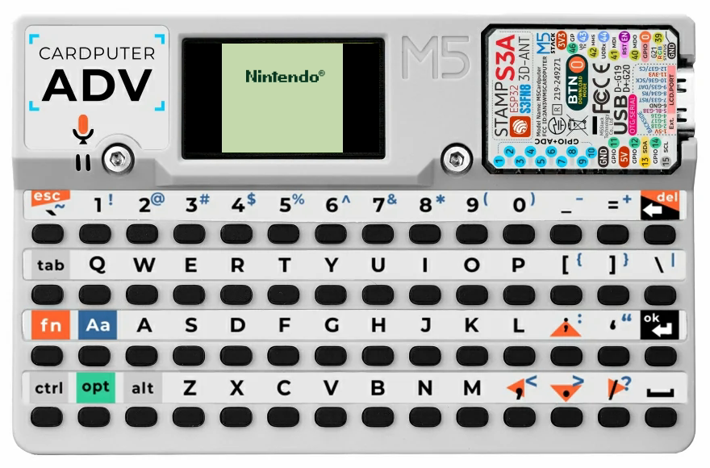
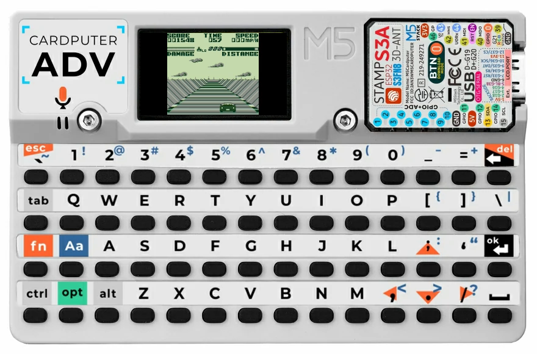
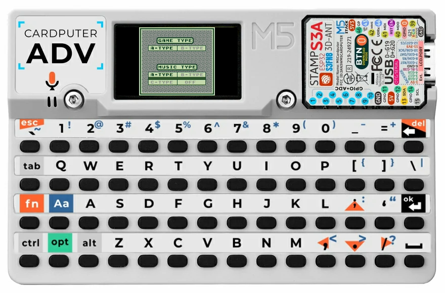
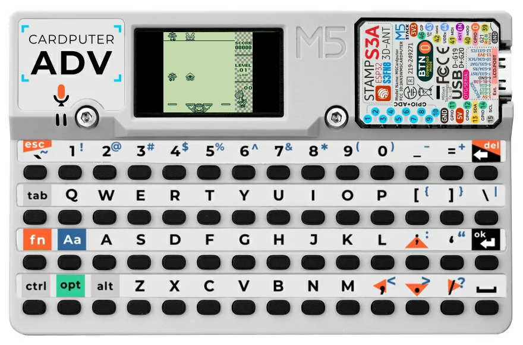
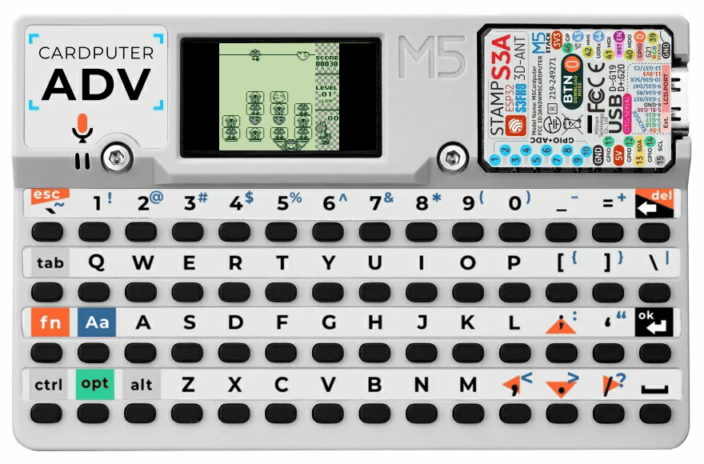

# Game Boy DMG para Cardputer ADV

Emulador independiente de la **Game Boy clásica** para **M5Stack Cardputer ADV**,
en la misma línea de los proyectos Amstrad CPC 464 y Spectrum 48K: archivos en
microSD, teclado integrado, audio emulado, selector por carpetas y firmware de
aplicación para M5Launcher. Sin PSRAM.

**V0.6 · instalada; mejora de audio confirmada en Super Chase H.Q.**
Reduce el trabajo gráfico de los fotogramas que no se presentan, manteniendo
la CPU y el sonido continuos. Corrige la matriz de botones y su interrupción,
sondea el teclado a unos 60 Hz y recuerda los ajustes y el último cartucho.
Conserva la sincronización de audio de V0.5 y el arranque DMG original. Añade
síntesis interna al doble de frecuencia y filtro FIR de 31 coeficientes antes
de reducir a los ~32 kHz del altavoz.

[Guía](docs/GUIA.md) · [Validación y límites](VALIDACION.md) ·
[Firmware](firmware/README.md) · [Créditos](THIRD_PARTY_NOTICES.md)

## Capturas y vídeos

Imagen y audio obtenidos por USB de la emulación ejecutada en un Cardputer ADV.
Las capturas se muestran dentro de la misma fotografía del equipo usada en los
proyectos Amstrad y Spectrum. La pantalla procede de la emulación; el marco es
una fotografía de producto de M5Stack. [Procedencia y originales](docs/media/README.md).

| Arranque original · V0.6 | Super Chase H.Q. · V0.6 |
| :---: | :---: |
|  |  |
| **Tetris · menú de juego y música · V0.3** | **Mario & Yoshi · partida · V0.4** |
|  |  |

### Partida en movimiento · Mario & Yoshi · V0.6

<p align="center">
  <a href="docs/media/gameplay-v06-cardputer-adv.mp4">
    
  </a>
  <br>
  <a href="https://github.com/NeXoDevLab/GameBoyCardputerADV/raw/refs/heads/main/docs/media/gameplay-v06-cardputer-adv.mp4"><strong>▶ Ver o descargar el vídeo con sonido · 12 segundos</strong></a>
</p>

La grabación muestra una partida en marcha, con desplazamientos a izquierda y
derecha, cambios de bandejas y caída de piezas. La vista animada es silenciosa;
el MP4 conserva el sonido generado por V0.6. Se mantiene la velocidad del reloj
emulado.

<p align="center">
  <a href="https://github.com/NeXoDevLab/GameBoyCardputerADV/raw/refs/heads/main/docs/hardware-20261122/superchase-v06-2x-pcm.mp4">▶ Prueba de sonido: Super Chase H.Q. · V0.6 · 3 segundos</a>
  <br>
  <a href="https://github.com/NeXoDevLab/GameBoyCardputerADV/raw/refs/heads/main/docs/hardware-20261122/tetris-original-boot.mp4">▶ Arranque original y entrada a Tetris · 10 segundos</a>
</p>

La grabación de Tetris es histórica (V0.1), anterior a las mejoras actuales de
audio. Los vídeos son capturas de la emulación; su sonido no es una grabación
acústica del altavoz.

## Descargas V0.6

- [BIN de aplicación para M5Launcher](firmware/GameBoy-CardputerADV-V0.6-app.bin).
- [Paquete SD: firmware, documentación y carpetas vacías](firmware/GameBoy-CardputerADV-V0.6-SD.zip).
- [SHA256 del BIN](firmware/SHA256SUMS) y [datos de compilación](firmware/BUILD-INFO.txt).

El código fuente completo está en este repositorio. Las versiones antiguas de
`firmware/` se conservan como referencia; usa V0.6 para la revisión actual.
El informe de validación identifica el hash del binario probado en el dispositivo;
`BUILD-INFO.txt` indica si coincide con el BIN recompilado que se publica.

## Arranque original

El modo **O: original**, seleccionado por defecto, ejecuta tu ROM de arranque DMG
de **256 bytes** desde la dirección cero. Esa ROM es la que debe generar el
desplazamiento del logo, el sonido de encendido y la entrada al cartucho. No se
añade una animación ni un sonido pregrabado. Si falta la ROM o su tamaño es
incorrecto, el programa muestra un aviso y no sustituye el arranque original.

Game Boy utiliza cartuchos: la experiencia original es el encendido y el arranque
del juego, sin una espera de cinta. El modo **R: directo** permite omitir la ROM de
arranque cuando se elige expresamente. La exactitud queda limitada por Peanut-GB
y MiniGB APU; no se afirma emulación ciclo a ciclo.

## Misma estructura de microSD

```text
/GAMEBOY/DMG.ROM                 tu ROM de arranque DMG: 256 bytes
/GAMEBOY/GAMES/GB/               tus cartuchos .gb
/GAMEBOY/GAMES/GB/Aventura/      subcarpetas opcionales
/GAMEBOY/GAMES/GB/Juego.gb
/GAMEBOY/GAMES/GB/Juego.sav      RAM de partida, creada al guardar
```

También se pueden abrir `.gb` sueltos en `GAMES/`. El selector oculta archivos
auxiliares `._` de macOS y archivos de partidas. Las carpetas se crean si faltan;
no se trasladan tus archivos ni se modifican las carpetas CPC464 o SPECTRUM.
**No se incluyen ROMs de arranque ni juegos**, tampoco dentro del firmware o ZIP.

## Funciones

- Game Boy DMG con núcleo Peanut-GB y audio de cuatro canales MiniGB APU.
- Cartuchos ROM, MBC1, MBC2, MBC3 y MBC5 sin periféricos especiales.
- Caché de SD de 64 KiB: los cartuchos grandes no se cargan enteros en RAM y no
  se borran particiones de flash para almacenarlos.
- Paleta verde y alternativa gris; imagen completa filtrada a 150×135, centrada
  y conservando proporción. Ancho completo 240×135 opcional.
- CPU/APU sincronizados al acceder a los registros de sonido. Intérprete en RAM interna y caché de cartucho
  optimizada; el escalado conserva los mismos píxeles que el filtro de referencia.
- Sonido de unos 32 kHz mediante I2S directo al ES8311, mezcla ancha con margen,
  volumen NR32 corregido, filtro de continua y ceros explícitos en pausa.
- El reloj del audio marca el ritmo; LCD y audio usan tareas separadas.
  Presentación LCD de unos 30 fps y sondeo del teclado de unos 60 Hz.
  Solo se construyen los píxeles de los fotogramas destinados a la pantalla.
- RAM de cartuchos con batería en `.sav`, guardado al abrir el selector,
  cambiar/reiniciar el juego, pulsar Fn+S y cada 30 segundos si hay cambios.
- Verificación de cada byte del guardado antes de publicarlo, copia anterior
  `.sav.bak` y archivo temporal `.sav.tmp`.
- Volumen, brillo, paleta, anchura, modo de arranque y último cartucho recordados
  en `/GAMEBOY/SETTINGS.INI`. Se guardan al abrir/cerrar el selector, cargar,
  reiniciar o usar Fn+S; no se escribe la SD continuamente durante la partida.
- Selector que vuelve a resaltar el último cartucho y ayuda integrada con H.
- Captura LCD y grabación USB de imagen y audio para preparar vídeos.

## Controles

| Tecla | Acción |
| --- | --- |
| Tab / G0 | Abrir o cerrar selector; guarda y pausa el juego |
| Flechas impresas sin Fn / WASD | Cruceta |
| Z / espacio | A |
| X | B |
| Enter | Start; en el selector, entrar/cargar |
| Retroceso | Select; en el selector, subir una carpeta |
| Izquierda/derecha en selector | Cambiar una página de seis filas |
| O / R en selector | Encendido original / entrada directa |
| Fn+= / Fn+- | Volumen en pasos de unos 5 puntos; inicial 30% |
| Fn+R | Reiniciar el cartucho con el modo seleccionado |
| Fn+S | Guardar RAM de partida |
| Fn+W | Proporción original / ancho completo |
| Fn+P | Verde / gris |
| Fn+B | Brillo: 64 / 128 / 180 / 255 |
| H en selector | Mostrar/ocultar ayuda de controles |

Antes de apagar, abre el selector con Tab y comprueba que no aparece un error de
guardado. Un corte de alimentación antes del guardado puede perder cambios
recientes. Los `.sav` guardan la RAM del cartucho, no una instantánea del emulador.

## Compilar y probar

Dependencias del entorno: Arduino CLI, M5Stack ESP32 **3.3.10**,
M5Cardputer **1.1.1**, M5Unified **0.2.28** y M5GFX **0.2.35**.
El script descarga versiones oficiales a `.build-deps/` la primera vez, sin
modificar las bibliotecas globales del ordenador. Requiere red en esa descarga;
las compilaciones siguientes reutilizan las copias locales.

```sh
sh tests/run_host.sh
sh scripts/build.sh
python3 scripts/package-sd.py
```

Perfil: ESP32-S3 a 240 MHz, flash QIO de 8 MB, `default_8MB`, PSRAM desactivada,
USB Hardware CDC/JTAG y CDC al arrancar. El BIN es de **aplicación**, para
M5Launcher; no es una imagen completa para escribir en la dirección cero.

## Límites de esta primera versión

- Solo Game Boy DMG y cartuchos compatibles con DMG. Game Boy Color exclusivo,
  Advance, ZIP, cámaras, vibración y cable link no están implementados.
- Validación estricta de cabecera, tamaños y checksum antes de entrar al núcleo.
- El tamaño máximo de ROM validable es 8 MiB; la RAM de cartucho depende de la
  memoria libre. No equivale a compatibilidad comprobada con esos cartuchos.
- RTC MBC3 avanza dentro del núcleo durante la sesión, pero no se conserva en
  disco ni avanza con el dispositivo apagado. No elegir esta versión para una
  partida que necesite un reloj persistente.
- Las faltas de caché de cartuchos grandes requieren lecturas SD y pueden
  provocar pausas. Los cartuchos grandes y sus faltas de caché necesitan más pruebas en hardware.
- El APU se sincroniza con resolución de muestra; conserva limitaciones de
  temporización y filtrado frente al hardware original.
  Una grabación USB puede tardar más que su duración emulada.

Los resultados reproducibles y la lista de comprobaciones físicas están en
[VALIDACION.md](VALIDACION.md).
