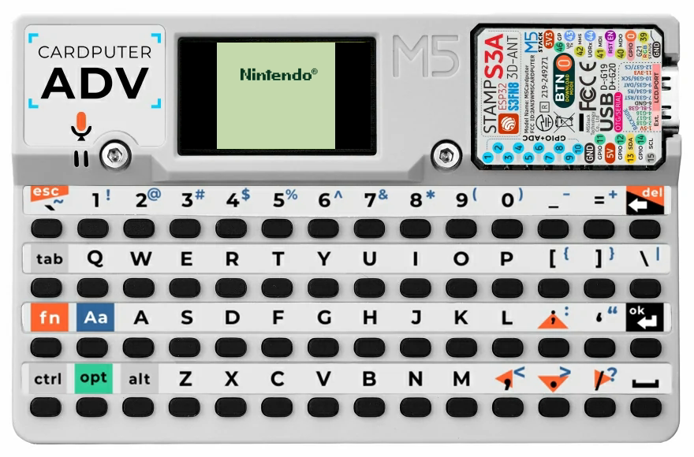
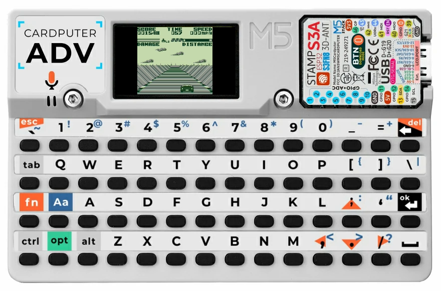
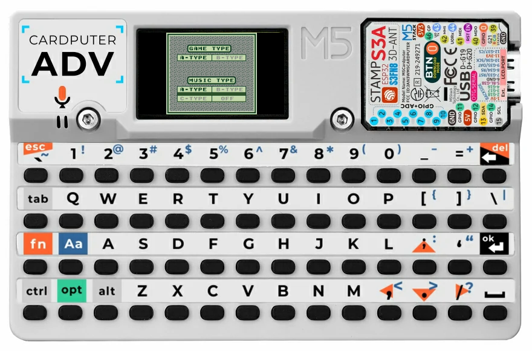
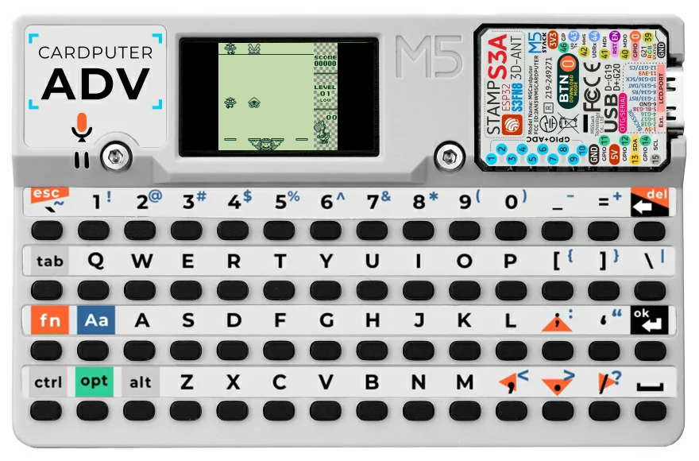

# Game Boy DMG for M5Stack Cardputer ADV

A standalone classic Game Boy emulator for the **Cardputer ADV** (ESP32-S3, 8 MB flash, no PSRAM).

## Gallery
Real USB captures placed inside the same Cardputer ADV product photograph used in our Amstrad and Spectrum projects. The screen contents come from the emulator.









[Watch Mario & Yoshi in motion with sound - 12 seconds, V0.6](https://github.com/NeXoDevLab/GameBoyCardputerADV/raw/refs/heads/main/docs/media/gameplay-v06-cardputer-adv.mp4)

## Features
- Executes your original 256-byte DMG boot ROM, including its logo and startup sound.
- Game cartridges on microSD, with folders and a built-in file selector.
- Four-channel sound, 2x internal oversampling, a 31-tap FIR filter and continuous I2S output.
- Green or grayscale palette; proportional screen or optional full-width view.
- Battery-backed cartridge RAM saved beside the game as `.sav`, with byte-by-byte verification and a previous `.bak` copy.
- Remembered volume, brightness, palette, display width and last game.

## microSD setup
Use a FAT32 microSD card:
```
/GAMEBOY/DMG.ROM        Your DMG boot ROM: exactly 256 bytes
/GAMEBOY/GAMES/GB/      Your .gb cartridges and optional subfolders
```
**No boot ROMs or games are included.** Game Boy Color-only cartridges are not supported.

## Controls
- Arrow keys without Fn, or WASD: direction
- Z / Space: A; X: B
- Enter: Start; Backspace: Select
- Tab / G0: game selector and pause
- Fn+R: reset; Fn+S: save cartridge RAM and settings
- Fn+P: palette; Fn+W: display width; Fn+B: brightness
- Fn+= / Fn+-: volume
- H in the selector: controls help

## Installation
This M5Burner download is a **complete standalone 8 MB image**, flashed at **0x000000**, including the bootloader and partition table. It replaces the existing firmware layout, including M5Launcher if installed.

For installation as an app inside **M5Launcher**, use the separate `GameBoy-CardputerADV-V0.6-app.bin` from the GitHub release instead.

## Source, downloads and validation
https://github.com/NeXoDevLab/GameBoyCardputerADV
https://github.com/NeXoDevLab/GameBoyCardputerADV/releases/tag/v0.6

The emulator application was tested on a Cardputer ADV; the full M5Burner image is assembled from the released app, generated bootloader and clean partition data. See the repository for test coverage and remaining compatibility limitations. The 8 MB image does not contain device backups, Wi-Fi credentials, ROMs or saved games.

MIT integration code. Peanut-GB and MiniGB APU retain their included MIT notices. Game Boy and Nintendo are trademarks of their respective owners. This project is not affiliated with Nintendo.
